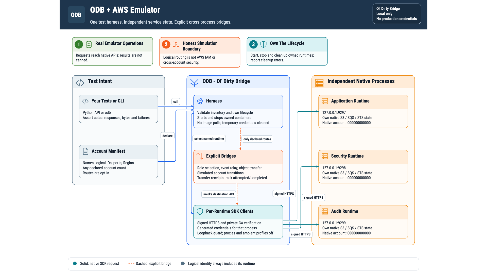
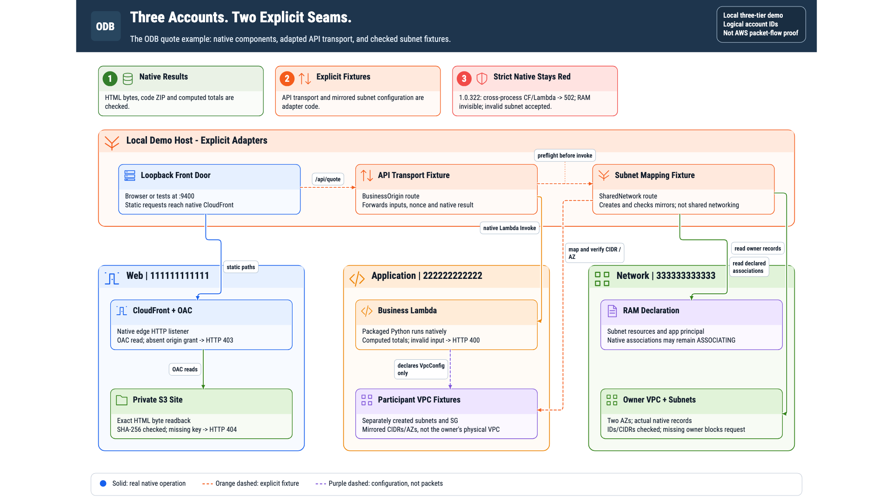

# ODB - Ol' Dirty Bridge

*Shimmying your requests between accounts.*

[](https://github.com/sam-fakhreddine/odb/actions/workflows/ci.yml)
[](LICENSE)

**v0.3.0 - early development.** A standalone multi-account shim for <!-- x-release-please-version -->
[`aws/aws-emulator`](https://github.com/aws/aws-emulator), licensed under MIT.
It is not affiliated with or supported by AWS.

An independently installable Python package for testing against multiple
local `aws/aws-emulator` processes. Copy this folder to another project, or
install it by path. It has no application, organizational-framework,
private-package, or session-directory dependency.

**This is account routing, not AWS authorization.** Each native process still
reports account `000000000000`. Logical IDs are separate metadata, not rewritten
AWS responses. Declared role selection, event relay, and S3 fixture transfer are
explicit simulations. They do not prove IAM, STS trust, KMS/bucket policy,
Security Hub/EventBridge delivery, snapshot sharing, or physical isolation.

## How it works

Think of ODB as a test harness around several separate AWS Emulator
instances, not as one emulator with real AWS accounts inside it. Each instance
has its own service state. ODB starts the instances, gives your test a client
for each one, and provides explicit bridges for a few interactions between
them.



### 1. Describe the accounts

An inventory is a JSON file that names each **logical account**, gives it a
synthetic account ID and a local port, and optionally declares routes between
accounts. For example, [`examples/accounts.json`](examples/accounts.json)
defines:

| Name | Logical ID | Local port |
| --- | --- | --- |
| `app` | `111111111111` | `9297` |
| `security` | `222222222222` | `9298` |
| `audit` | `333333333333` | `9299` |

These IDs are labels ODB uses in routing and receipts. Every emulator process
still reports `000000000000`; ODB does not rewrite native responses. The
inventory also declares a simulated role from `security` to `app`, an event
bridge from `audit` to `security`, and an evidence bridge from `app` to
`security`.

### 2. Start the harness and use account clients

Entering `with Harness(...)` starts one container per account. Each process
has its own state, generated credentials, and HTTPS endpoint. ODB creates
account-scoped boto3 clients with the process's credentials and verified
private certificate, then stops the containers and cleans up on exit.

```python
from aws_emulator_shim import Harness

with Harness("examples/accounts.json", seed=7) as odb:
    app_s3 = odb.client("app", "s3")
    security_s3 = odb.client("security", "s3")
    app_s3.create_bucket(Bucket="example-evidence")
```

The bucket is created in the `app` emulator, not the `security` emulator.
The emulator handles the S3 request; ODB selects the client and endpoint.
ODB-created clients are guarded to their assigned loopback endpoints, but
independently created SDK clients are not intercepted. ODB is not a network
sandbox. See [Setup](#setup) for the required local image and container engine.

### 3. Communicate through explicit bridges

The accounts do not automatically discover or communicate with each other
through ODB. Your test calls ODB when it wants a supported interaction, and
ODB acts as the middleman:

- **Role selection:** `assume_role("security", "SecurityAccess")` checks the
  declared route and selects the `app` emulator. It does not call STS or
  evaluate IAM permissions.
- **Event relay:** `relay_event("audit", payload, queue)` checks the event
  route and sends an envelope to a destination SQS queue created through ODB.
  It does not automatically forward EventBridge events.
- **Evidence transfer:** after an explicit grant, `transfer(...)` reads an S3
  object from the source emulator and writes it to the destination emulator.
  ODB checks the bytes, records a SHA-256 receipt, and limits the copy to
  1 MiB. This does not evaluate AWS cross-account S3, KMS, or IAM policies.

For example, the event path is:

```text
Your test calls relay_event
  -> ODB checks the audit-to-security route
  -> ODB sends an SQS message to the security emulator
```

The [Inventory and API](#inventory-and-api) section shows the corresponding
calls. This is like a person carrying a message between rooms, not a phone line
the rooms can use automatically.

### 4. Interpret the result

A passing test shows that the tested code worked with the local emulator
responses and any explicitly simulated ODB bridges used by that test. It does
not prove real AWS authorization, event delivery, or cross-account resource
sharing. ODB also has an offline evidence contract that can label
caller-supplied observations as native, adapted, or unknown; it does not
automatically trace every SDK call or prove the recorded operation happened.

### A larger example



The [three-account example](examples/three_tier/README.md) checks native HTML
bytes and computed Lambda results, then deliberately breaks routes, resources
and grants. On emulator 1.0.322, strict native mode still fails for cross-process
CloudFront/Lambda forwarding, RAM subnet visibility and missing-subnet
validation. The fixtures do not prove AWS authorization or packet connectivity.

[Vector diagrams, PDFs, editable Mermaid/design sources and rendering notes](docs/diagrams/README.md)
are included. These diagrams describe the source on `main`; the existing
v0.1.0 release assets are unchanged.

## Setup

Get the versioned source (including examples) from
[GitHub Releases](https://github.com/sam-fakhreddine/odb/releases), or clone:

```sh
git clone --branch v0.3.0 https://github.com/sam-fakhreddine/odb.git # x-release-please-version
cd odb
```

Requires Python 3.11+, boto3, a running container engine, and an existing local
emulator image. Podman is the verified engine. A Docker-compatible CLI selector
is provided; an actual Docker Engine has not been validated. Running `docker`
through a Podman alias is not Docker Engine validation.

```sh
python3 -m venv .venv
.venv/bin/python -m pip install .
export AWS_EMULATOR_IMAGE=localhost/aws-emulator:1.0.322
.venv/bin/python -m aws_emulator_shim examples/accounts.json
```

`odb` and `aws-emulator-shim` are equivalent installed CLI entry points.
The distribution/import names remain `aws-emulator-shim`/`aws_emulator_shim`.
No PyPI package has been published; install the reviewed source or wheel from
the release rather than assuming a same-named PyPI project belongs to ODB.

The image is deliberately not downloaded automatically, and there is no claimed
official prebuilt emulator image. The included Containerfile builds from an
official Linux RPM you obtain and verify separately:

```sh
# Place the official, verified architecture-appropriate RPM in this directory.
podman build -f Containerfile \
  --build-arg EMULATOR_PACKAGE=aws-emulator-aarch64.rpm \
  -t localhost/aws-emulator:1.0.322 .
```

Use the x86_64 package and matching build architecture on x86_64 hosts. Package
files and images are not distributed with this folder. The required image
contract is an `aws-emulator` entry point accepting `--port`/`--idle-timeout`,
with generated `emulator_credentials` and `ca.pem` under
`/home/emulator/.aws/emulator/<port>/`. The Containerfile implements that
contract. Its base tag is mutable; record actual image IDs and package hashes
when reproducing results.

## Inventory and API

`examples/accounts.json` is a synthetic three-account example, not a required
topology. Supply any nonempty account mapping, distinct 12-digit logical IDs
other than the native all-zero ID, and distinct available unprivileged ports.
`roles` and `bridges` are optional. `events` and `evidence` are the two supported
bridge types; omit them if the scenario does not need them.

```python
from aws_emulator_shim import Harness

with Harness("examples/accounts.json", seed=7, clock=lambda: 123.0) as harness:
    app_s3 = harness.client("app", "s3")
    selected = harness.assume_role("security", "SecurityAccess")
    assert selected.account == "app"  # selection only, not STS authorization
    queue = harness.create_queue("security", "example-receipts")
    harness.relay_event("audit", {"case": "synthetic-case"}, queue)
```

Caller-defined account names, IDs, Region and ports need no source edits.
Image precedence is `runtime_images[account]`, then the `image` argument,
manifest `image`, and `AWS_EMULATOR_IMAGE`. The engine is selected by the
`engine` argument, manifest `engine`, or `AWS_EMULATOR_ENGINE` (default
`podman`). The CLI also accepts `--image`, `--engine`, and `--seed`.
Per-account image overrides support narrowly patched runtimes without changing
other accounts; no application-specific patch is required for the generic suite.

Clients use per-process generated credentials, verified private-CA HTTPS, and
account-scoped sessions/caches. Ambient AWS profiles/configuration are ignored
without changing the caller's environment. Requests through these clients are
guarded to their declared loopback endpoints; proxies are disabled. Direct SDK
clients created by the application are **not** automatically intercepted. This
library is not an OS network sandbox and does not execute untrusted code safely.

The CLI checks native STS identity, exact S3 bytes and SQS receipts for every
declared account, cleans up, and only then emits `"status": "PASS"`.
It does not claim that cross-account security has been proven.

For S3 transfer, create source/destination objects and buckets first, then call
`grant_transfer(source_bucket, source_key, target_bucket, target_key)` and
`transfer(...)`. Copies are limited to 1 MiB, checked byte-for-byte, and retain
their SHA-256 and account lineage in `harness.trace`. Conflicting existing
destination bytes are rejected. Revoking a grant prevents subsequent copies
but does not delete retained evidence. Failed or unconfirmed writes remain
`attempted`, never `completed`.

### Strict typed inventories (unreleased)

The development source adds a Python schema-first boundary using Pydantic 2,
not a TypeScript rewrite. The published v0.1.0 release assets do not include it.
Opt in per harness or with `odb examples/accounts.json --strict-manifest`.
Legacy parsing remains the default.

```python
from aws_emulator_shim import Harness, load_manifest

inventory = load_manifest("examples/accounts.json")  # offline validation
port: int = inventory.accounts["app"].port
harness = Harness(inventory, seed=7, image="local-test", strict_manifest=True)
# Construction validates; only entering the harness starts emulator processes.
```

`Account`, `Route` and `Manifest` provide static field types, strict runtime
validation and immutable model/mapping snapshots. `parse_manifest(data)` accepts
unknown in-memory data. Ports must be integers, not strings, floats or booleans;
unknown fields, duplicate IDs/ports and undeclared routes are rejected. Only
`events`/`evidence` bridge names are supported in strict mode. Schema version 1
is the default when omitted. Image/engine environment precedence is unchanged.

`load_manifest` rejects duplicate JSON keys, malformed UTF-8/JSON and non-finite
numbers. Public `ManifestError.issues` contain safe field paths/error codes, not
rejected values; dynamic names become `*`. Use these parsers at untrusted
boundaries, not Pydantic's trusted `model_construct`/`model_copy` escape hatches
or raw exception-detail dumps.

The [generated JSON Schema](docs/schemas/manifest-v1.schema.json) describes
structural rules. Cross-record uniqueness and route relationships additionally
require `parse_manifest`/`load_manifest`; JSON Schema alone is not sufficient.
Regenerate with `python -m aws_emulator_shim.schema --output docs/schemas/manifest-v1.schema.json`.
Strict mypy currently covers contracts/schema and consumer fixtures, **not all
legacy harness/runtime SDK code**. Subsequent seams extend that scope before
adding new boundary models.

## Tests

Development follows [thin seams with just-in-time grooming](AGENTS.md).
The [seam index](docs/groom/index.md) distinguishes implemented work from future
features; [CONTRIBUTING.md](CONTRIBUTING.md#seam-development) documents freshness
checks and the disposable offline setup gate.

Fast CI checks need no emulator, container engine, AWS account or credentials:

```sh
python3 -m pip install -e '.[dev]'
python3 -m ruff check .
python3 -m unittest discover -s tests/unit -v
python3 scripts/check_types.py
python3 -m aws_emulator_shim.schema --check docs/schemas/manifest-v1.schema.json
python3 -m build
python3 -m twine check dist/*
```

CI runs those unit checks on Python 3.11-3.14 and builds the source distribution
and wheel. **A green CI badge does not mean native emulator integration ran.**
The unit tests use controlled lifecycle doubles to check validation, endpoint
guards and cleanup; they do not prove any AWS service behavior.

### Real integration tests

From this folder, with boto3 already installed:

```sh
AWS_EMULATOR_IMAGE=localhost/aws-emulator:1.0.322 \
  python3 -m unittest discover -s tests -v
```

The seven tests cover arbitrary two-/three-account inventories, use outside the
project directory, a non-default Region, ambient-profile isolation, native
state separation, declared roles, event receipts, evidence retention, rejected
routes, real-backend outage/lost-response uncertainty and the three-tier example.
The generic suite was previously tested with boto3 1.40.66; the expanded suite
was tested with boto3 1.43.73. The dependency range is not a claim that every newer
SDK or emulator release has been validated.

The library owns container IDs and temporary credential directories and cleans
them up on normal completion and Python exceptions. Containers are capped at
2 GiB and one CPU each; budget host capacity for the account count. Use a fresh
Harness per scenario and disjoint ports for overlapping runs. Port reservation,
hard-kill recovery and concurrent-run acceptance are not established. The
namespace prefixes CLI smoke resources; library callers still name their own
resources.

## Distribution and versioning

This folder can be copied independently. Do not copy application integration
tests, organization-specific adapters, credentials, RPMs, images, caches, or
private application sources into a public distribution. ODB code is
[MIT-licensed](LICENSE); emulator software has its own license and is not
redistributed. The source distribution includes examples/tests/docs; the wheel
contains the library, entry points and license.

Releases use [Semantic Versioning](https://semver.org/): `MAJOR.MINOR.PATCH`,
with matching `vMAJOR.MINOR.PATCH` Git tags and package metadata.
Before 1.0, incompatible API/configuration changes increment the minor version;
patch releases preserve the documented interface. See [CHANGELOG.md](CHANGELOG.md)
and [CONTRIBUTING.md](CONTRIBUTING.md) for the release process.

## Three-tier application example

The [three-account quote application](examples/three_tier/README.md) adds real
CloudFront/private-S3 serving, native business Lambda execution and network-owned
VPC/subnet/RAM metadata. Its HTTP API relay and participant subnet mapping are
explicit fixtures. The normal command proves adapted plumbing with fault
injection; `--strict-native` stays red for missing cross-process capabilities.
It can also serve the example site on loopback with `--serve 9400`.
