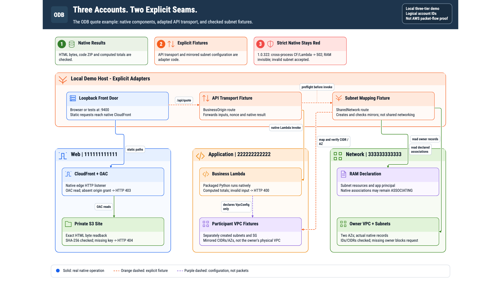

# ODB three-account example

A runnable, synthetic quote application using the reusable shim. It requires
no forensic application, private packages, deployment, or real AWS credentials.
The account IDs below are logical harness metadata; every native process still
reports `000000000000`.



The solid paths are native operations; orange dashed paths are explicit
fixtures. The purple dashed path records Lambda's `VpcConfig`, not packet
connectivity. [Vector/PDF versions and editable sources](../../docs/diagrams/README.md)
are available.

| Logical account | Native resources | Proven locally |
| --- | --- | --- |
| Web `111111111111` | Private S3 site, CloudFront distribution, S3/Lambda OACs | Actual edge HTTP returns the uploaded HTML byte-for-byte; deleting the object returns 404; removing the bucket grant returns 403 |
| Application `222222222222` | Packaged Python business Lambda, IAM execution role, IAM-authenticated function URL, participant VPC/subnet fixtures | Native Lambda executes input-dependent calculations; invalid inputs return 400; creating a VPC-configured function without network permissions fails |
| Network `333333333333` | Owner VPC, two subnets, RAM resource share and principal/resource declarations | Native resources and share associations can be read back; the explicit fixture verifies owner/participant CIDRs, AZs, subnet IDs and Lambda configuration |

## Run from the package source folder

Requires Python 3.11+, boto3, Podman, free ports 9297-9299, and the local
emulator image described in the [package README](../../README.md).
The image must also contain `curl`, because native CloudFront creates a
loopback edge listener **inside its container**. No container-to-host origin
connection or public function URL is used.

```sh
export AWS_EMULATOR_IMAGE=localhost/aws-emulator:1.0.322
PYTHONPATH="$PWD" python3 -m examples.three_tier.demo --report result.json
PYTHONPATH="$PWD" python3 -m examples.three_tier.demo \
  --strict-native --report native-result.json
```

The first command must finish with `"status": "PASS_ADAPTED"` and exit 0.
It performs real HTTP requests, native SDK operations and fault injection,
then stops its owned containers and HTTP listener. The second runs the same
checks but exits **1** with `"status": "FAIL_NATIVE"` while any native
cross-process diagnostic fails. These are not expected-failure/skip decorators
or manufactured success responses.

The verified release is emulator 1.0.322. Actual diagnostics are recorded on
every run, not hardcoded to that release. A newer release may change results.
The standalone package's wheel contains the library, not these example assets;
retain this source folder to run the example.

For an interactive site, with a separate run and the same free emulator ports:

```sh
PYTHONPATH="$PWD" python3 -m examples.three_tier.demo --serve 9400
```

Open `http://127.0.0.1:9400`; Ctrl-C stops the listener and containers. This is
the **adapted local front door**, not a native CloudFront public endpoint.
Only one run at a time may use this manifest. `--manifest` accepts a copy with
different ports/logical IDs; the scenario uses the `web`, `application` and
`network` account names and its two explicitly named routes.

## The two explicit shim seams

**API transport:** the loopback HTTP server forwards static requests to the
actual CloudFront edge listener. For `/api/quote`, it reads the native
CloudFront route/origin configuration, selects the manifest's `BusinessOrigin`
route, and calls native Lambda `Invoke` in the application process. It passes
query parameters and a fresh request ID, and returns the handler's actual
status/body. It does **not** precompute prices, execute the handler locally,
copy a business Lambda into the web process, or claim to enforce function-URL
IAM/OAC policy.

**Subnet visibility:** native RAM shares do not propagate between these
processes. The example creates an owner VPC/subnets in the network process
and a **second VPC with separately created subnet fixtures** in the application
process. Each invocation checks the explicit `SharedNetwork` route, native RAM
principal/resource declarations, both native subnet records and Lambda's
actual `VpcConfig`. Native associations may still say `ASSOCIATING`; the
fixture is explicitly enabled locally, not represented as a native accepted
share. Removing either route or referring to an absent owner subnet refuses
the request. This is configuration/routing proof, **not packet connectivity**.

The participant-only canary VPC demonstrates independent native state and
avoids accidentally relying on the emulator assigning identical IDs to the
mirrored subnet resources. Native IDs need not be unique across processes.
Account identity must always include the selected runtime.

## Proof and falsification

The normal run checks exact HTML bytes/SHA-256, native Lambda ZIP SHA-256,
two different calculated totals, per-request nonce roundtrips and resource
ownership. A temporary CloudFront distribution **inside the application
process** also calls the same native Lambda URL with OAC and both resource
grants. That positive control isolates the failing seam: same-process
CloudFront/Lambda works; cross-process forwarding does not in the tested image.
The diagnostic distribution is removed afterward.

Fault injection is mandatory: invalid business inputs, missing execution-role
network permissions, removed business/network routes, an absent owner subnet,
deleted S3 origin object, removed S3 origin grant, changed native API origin,
deleted business Lambda and a stopped application backend must all fail.
Unsuccessful native invocations are never converted into a quote.
The handler runs in the emulator's embedded Python runtime; this is not AWS
Lambda managed-runtime, ABI, cold-start or production-runtime parity.

The strict native diagnostics remain separate from that adapted result:

| Diagnostic on 1.0.322 | Observed result |
| --- | --- |
| Web CloudFront directly calls the application process's Lambda URL | HTTP 502, despite OAC and both scoped Lambda grants |
| Participant sees owner RAM share and the original owner subnet IDs without mapping | No shared resources visible |
| Native Lambda rejects a nonexistent subnet ID | It accepts the invalid configuration |

The demo never resolves or sends requests to a public Lambda URL. SDK clients
retain the shim's CA verification, generated local credentials and endpoint
guards. The optional HTTP listener binds only loopback, disables upstream
proxies, and forwards only to owned runtimes. This is not a security sandbox.
Reports contain synthetic resources/results, not generated credentials.

## Real AWS interpretation

In AWS, the third account can own a VPC and share subnets through RAM within
an organization. The participant account owns its Lambda and security groups
in those shared subnets. Lambda compute remains in a Lambda-managed VPC;
`VpcConfig` supplies customer-network connectivity through Hyperplane ENIs.
CloudFront can use a private S3 origin and an IAM-authenticated Lambda URL
origin with OAC.

None of the subnet fixture, invocation relay, recorded KMS/IAM metadata or
native acceptance proves real cross-account authorization, ENI provisioning,
route tables, security-group enforcement, DNS, NACLs or packet flow. Those
require separately authorized AWS acceptance.

References: [VPC sharing](https://docs.aws.amazon.com/vpc/latest/userguide/vpc-sharing.html),
[Lambda VPC connectivity](https://docs.aws.amazon.com/lambda/latest/dg/configuration-vpc.html),
[CloudFront Lambda URL OAC](https://docs.aws.amazon.com/AmazonCloudFront/latest/DeveloperGuide/private-content-restricting-access-to-lambda.html).
